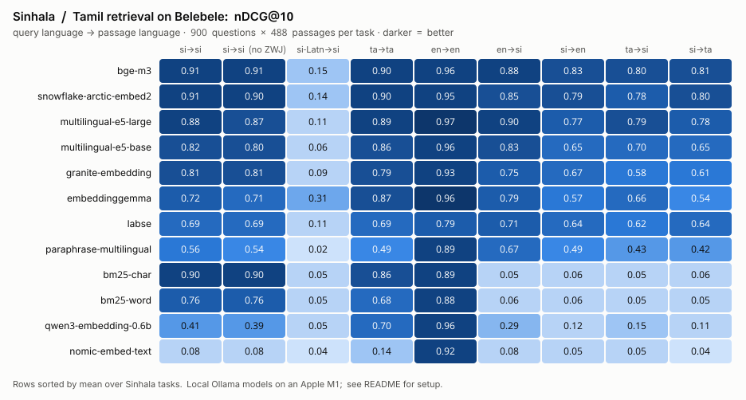

# lanka-rag

[](https://github.com/Nipuna-Lakruwan/lanka-rag/actions/workflows/ci.yml)
[](https://pypi.org/project/lanka-rag/)
[](https://github.com/Nipuna-Lakruwan/lanka-rag/blob/main/LICENSE)
[](https://github.com/Nipuna-Lakruwan/lanka-rag/blob/main/pyproject.toml)
[](https://ollama.com)

Sinhala embedding benchmark · Tamil retrieval · Singlish · local RAG for Sri Lanka ·
සිංහල · தமிழ்

**Which embedding model actually understands Sinhala?** This repo has a reproducible retrieval
benchmark for Sinhala, Tamil and Singlish (romanized Sinhala), plus a local-first RAG assistant
for Sri Lankan documents built with LangChain and Ollama. Everything runs on a laptop with no
API keys.

## Key findings

Eight Ollama embedding models and two BM25 baselines, nine tasks, 900 questions each, on an
Apple M1 with 8 GB of RAM.

1. **Use `bge-m3` for Sinhala and Tamil.** It is best on 7 of 9 tasks, including every
   cross-lingual one (nDCG@10 0.913 Sinhala, 0.900 Tamil, 0.879 English→Sinhala).
   `snowflake-arctic-embed2` is a close second (0.906 Sinhala, a tie on Tamil) and their 95%
   CIs overlap. The two tasks bge-m3 loses, English and Singlish, go to `embeddinggemma`.
2. **The popular default is near-random on Sinhala.** `nomic-embed-text`, the embedding model in
   many Ollama RAG tutorials, scores 0.078 on Sinhala and 0.142 on Tamil while scoring 0.923 on
   English. A RAG app built on it will quietly fail for Sri Lankan users.
3. **Character n-gram BM25 almost matches the best model within one language.** 0.899 vs 0.913
   on Sinhala, with no model at all. It beats every dense model except bge-m3 and snowflake.
   Word-level BM25 is 14 points worse on Sinhala and 18 on Tamil, because Sinhala and Tamil
   attach case markers and postpositions to words. Lexical search only fails across languages,
   which is why the RAG app uses both (hybrid retrieval).
4. **A strong English score says nothing about Sinhala.** `qwen3-embedding:0.6b` scores 0.956
   on English and 0.410 on Sinhala. It is also the slowest model here on Sinhala (0.65 passages/s
   vs 9 for bge-m3), because its tokenizer spends up to ~2,000 tokens on a 75-word passage.
5. **Nobody can search Sinhala in Singlish yet.** The best model, `embeddinggemma`, gets 0.309
   nDCG@10 (21% Recall@1) for romanized questions. bge-m3 gets 0.154. This is the most useful
   gap to close, since it is how most people type Sinhala on a phone.
6. **Typing without zero width joiners costs dense models about 1 point.** Small but consistent
   (bge-m3 0.913 → 0.906, paraphrase-multilingual 0.557 → 0.536). BM25 is unaffected because the
   tokenizer strips ZWJ.

Two notes on fairness: `paraphrase-multilingual` reads at most 128 tokens, so it sees only the
start of long Sinhala passages, and the speed column was measured with nothing else running on
the machine. No model hit its context limit on these passages (checked in the Ollama logs).

<picture>
  <source media="(prefers-color-scheme: dark)" srcset="https://raw.githubusercontent.com/Nipuna-Lakruwan/lanka-rag/main/results/ndcg_heatmap_dark.svg">
  
</picture>

## Results

<!-- RESULTS:START -->
**nDCG@10** (higher is better; best per column in bold). "Sinhala avg" averages every task with Sinhala on either side.

| Model | Params | Sinhala avg | si→si | si→si (no ZWJ) | si-Latn→si | ta→ta | en→en | en→si | si→en | ta→si | si→ta |
|---|---:|---:|---:|---:|---:|---:|---:|---:|---:|---:|---:|
| bge-m3 | 568M | 0.757 | **0.913** | **0.906** | 0.154 | **0.900** | 0.955 | **0.879** | **0.835** | **0.802** | **0.811** |
| snowflake-arctic-embed2 | 568M | 0.739 | 0.906 | 0.897 | 0.143 | 0.900 | 0.945 | 0.852 | 0.794 | 0.784 | 0.797 |
| granite-embedding | 278M | 0.616 | 0.814 | 0.806 | 0.092 | 0.792 | 0.931 | 0.752 | 0.668 | 0.578 | 0.607 |
| embeddinggemma | 308M | 0.613 | 0.718 | 0.706 | **0.309** | 0.868 | **0.965** | 0.790 | 0.567 | 0.664 | 0.539 |
| paraphrase-multilingual | 278M | 0.446 | 0.557 | 0.536 | 0.022 | 0.493 | 0.885 | 0.667 | 0.489 | 0.433 | 0.420 |
| bm25-char | - | 0.295 | 0.899 | 0.899 | 0.046 | 0.863 | 0.888 | 0.052 | 0.063 | 0.053 | 0.056 |
| bm25-word | - | 0.254 | 0.755 | 0.755 | 0.046 | 0.680 | 0.879 | 0.059 | 0.062 | 0.051 | 0.053 |
| qwen3-embedding-0.6b | 0.6B | 0.218 | 0.410 | 0.392 | 0.049 | 0.697 | 0.956 | 0.291 | 0.121 | 0.147 | 0.114 |
| nomic-embed-text † | 137M | 0.059 | 0.078 | 0.078 | 0.040 | 0.142 | 0.923 | 0.075 | 0.052 | 0.050 | 0.041 |

† English-centric model, included as a control.

**Recall@1 / Recall@10** on the three monolingual tasks, plus 95% bootstrap CI of nDCG@10 for si→si:

| Model | si→si R@1 | si→si R@10 | si→si nDCG@10 95% CI | ta→ta R@1 | Singlish→si R@1 | Embed speed (passages/s) |
|---|---:|---:|---:|---:|---:|---:|
| bge-m3 | 0.851 | 0.966 | 0.896–0.928 | 0.838 | 0.099 | 9.25 |
| snowflake-arctic-embed2 | 0.850 | 0.958 | 0.890–0.921 | 0.839 | 0.087 | 7.49 |
| granite-embedding | 0.716 | 0.908 | 0.793–0.835 | 0.701 | 0.056 | 13.86 |
| embeddinggemma | 0.621 | 0.818 | 0.693–0.745 | 0.794 | 0.213 | 8.54 |
| paraphrase-multilingual | 0.417 | 0.717 | 0.531–0.585 | 0.366 | 0.004 | 27.33 |
| bm25-char | 0.837 | 0.952 | 0.883–0.915 | 0.797 | 0.032 | - |
| bm25-word | 0.669 | 0.842 | 0.729–0.780 | 0.592 | 0.038 | - |
| qwen3-embedding-0.6b | 0.278 | 0.553 | 0.382–0.436 | 0.603 | 0.030 | 0.65 |
| nomic-embed-text | 0.058 | 0.107 | 0.063–0.095 | 0.092 | 0.026 | 30.7 |
<!-- RESULTS:END -->

Raw per-query ranks for every model are in [`results/raw/`](https://github.com/Nipuna-Lakruwan/lanka-rag/tree/main/results/raw), so you can run your
own error analysis or significance tests.

## The benchmark

Sinhala has very little retrieval evaluation data. [Belebele](https://huggingface.co/datasets/facebook/belebele)
(Meta, CC BY-SA 4.0) has 900 human-written questions over 488 passages, and the *same*
questions and passages exist in Sinhala script, romanized Sinhala, Tamil and English. Since every
language is aligned by passage, one dataset gives nine tasks with identical relevance labels:

| Task | Query | Passages | What it tells you |
|---|---|---|---|
| `si→si` | Sinhala | Sinhala | Basic Sinhala retrieval |
| `si→si (no ZWJ)` | Sinhala, zero width joiners removed | Sinhala | Robustness to how people actually type (`ශ්රී` vs `ශ්‍රී`). Many phone keyboards drop the ZWJ |
| `si-Latn→si` | Singlish | Sinhala | Can users search Sinhala documents the way they text? |
| `ta→ta` | Tamil | Tamil | Basic Tamil retrieval |
| `en→en` | English | English | Reference: is the model any good at all? |
| `en→si`, `si→en` | | | Cross-lingual, the common case for bilingual Sri Lankan documents |
| `ta→si`, `si→ta` | | | Tamil ↔ Sinhala without going through English |

Each query has exactly one relevant passage. Metrics: nDCG@10 (main), MRR@10 and Recall@1/5/10,
with 95% bootstrap confidence intervals.

MTEB already has a `BelebeleRetrieval` task. This benchmark adds the Singlish, ZWJ-robustness and
Tamil↔Sinhala tasks, local models you can actually run through Ollama, the exact prompt
format each model expects ([`models.py`](https://github.com/Nipuna-Lakruwan/lanka-rag/blob/main/src/lanka_rag/models.py)), and lexical baselines that
handle Sinhala correctly.

### Sinhala text pitfalls this code handles

- **`\w` regexes shred Sinhala words.** Vowel signs are combining marks, which Python's `\w`
  doesn't count as word characters: `re.findall(r"\w+", "ජනාධිපතිවරයා")` returns
  `['ජන', 'ධ', 'පත', 'වරය']`. [`text.tokenize`](https://github.com/Nipuna-Lakruwan/lanka-rag/blob/main/src/lanka_rag/text.py) splits on
  Unicode categories instead, so a naive BM25 baseline here is not secretly broken.
- **ZWJ spellings.** `ශ්‍රී` (with U+200D) and `ශ්රී` are the same word. Lexical matching strips
  ZWJ, and stray joiners that don't follow the virama are removed everywhere.
- **Two encodings of one vowel sign.** `ො` can be stored as U+0DDC or as `ෙ` + `ා`. Everything is NFC
  normalized.
- **Legacy-font PDFs.** Many government PDFs use pre-Unicode fonts (FM Abhaya, DL-Manel), so the
  extracted "text" looks like `Y%S ,xld`. `lanka-rag inspect file.pdf` flags these pages, and
  ingestion skips them so garbage never reaches the vector store.

## Quick start

Needs [Ollama](https://ollama.com). To use the CLI and the library, install from PyPI:

```bash
pip install lanka-rag
```

To reproduce the benchmark or run the Acts demo, clone the repo and use
[uv](https://docs.astral.sh/uv/):

```bash
git clone https://github.com/Nipuna-Lakruwan/lanka-rag.git
cd lanka-rag
uv sync
```

### Reproduce the benchmark

```bash
uv run lanka-rag bench download
```

```bash
uv run lanka-rag bench run bm25-word bm25-char bge-m3 embeddinggemma --pull
```

```bash
uv run lanka-rag bench report
```

`--pull` downloads missing Ollama models and `--rm-after` deletes them again after scoring
(handy on a small disk). Embeddings are cached in `.cache/`, so you can rerun the report for free.
`uv run lanka-rag bench models` lists every model and the prompts it uses. Hugging Face models
(multilingual-e5, LaBSE) need `uv sync --extra hf`.

### Ask questions over your own documents

The demo corpus is 1,010 hand-corrected pages of Sri Lankan Acts (1981–2019) in Sinhala, from
[sinhala-ocr-lk-acts-1010](https://huggingface.co/datasets/avishadilhara/sinhala-ocr-lk-acts-1010)
(CC BY 4.0). Drop your own PDFs, `.txt`, `.md` or `.html` files into `docs/` the same way.

```bash
uv run python scripts/fetch_acts_demo.py
```

```bash
uv run lanka-rag ingest docs/acts --embedding bge-m3
```

```bash
uv run lanka-rag ask "තුරුසවිය අරමුදලේ පරමාර්ථ මොනවාද?"
```

```bash
uv run lanka-rag chat
```

Retrieval is hybrid: dense embeddings plus character n-gram BM25, fused with reciprocal rank
fusion ([`rag/store.py`](https://github.com/Nipuna-Lakruwan/lanka-rag/blob/main/src/lanka_rag/rag/store.py)). BM25 only scores chunks in the
question's language, because across languages it matches on numbers and stray Latin letters and
adds noise. The answer comes from a local Ollama chat
model (default `qwen3:4b-instruct-2507-q4_K_M`, change it with `--llm`). It answers in the
language of the question and cites the passages it used.

### Docker

```bash
docker compose up -d ollama
```

```bash
docker compose exec ollama ollama pull bge-m3
```

```bash
docker compose run --rm app ingest /docs
```

## Layout

```
src/lanka_rag/
  text.py          Sinhala/Tamil normalization, tokenizer, char n-grams, legacy-font detector
  models.py        embedding model registry + per-model query/document prompts
  embedders.py     Ollama / Hugging Face embedders with an on-disk cache
  bm25.py          BM25 over Unicode-aware tokens or char n-grams
  bench/           Belebele tasks, metrics, runner, report + heatmap
  rag/             ingestion, hybrid LangChain retriever, LCEL answer chain
scripts/           demo corpus download
tests/             unit tests (no network or models needed)
```

## Limitations

- Belebele passages are professional translations of English Wikinews, Wikivoyage and Wikibooks
  text (FLORES-200), not native Sri Lankan writing. Expect real gazettes and news to be harder.
- 488 passages is a small corpus. Absolute scores are higher than on a real document collection,
  so read the table as a ranking of models.
- Many questions start with "according to the passage" (`ඡේදයට අනුව`), which adds the same noise
  for every model.
- This measures retrieval only. Answer quality of the RAG chain is not benchmarked yet, and the
  small default chat model is the weak link. Asked in English whether the Trust Fund Act lets the
  board invest money not immediately needed, retrieval puts the exact clause at rank 2, but
  `qwen3:4b` still replies that it could not find the answer. Same-language questions
  (Sinhala question over Sinhala Acts) work much better. A bigger model (`--llm`) helps if you
  have the RAM.
- Sinhala is expensive for LLMs: about 1.3 tokens per character in Qwen's tokenizer, so four
  800-character chunks already make a ~4k token prompt. On an 8 GB M1 an answer takes 1–2.5
  minutes.

## Roadmap

- [ ] FM Abhaya / DL-Manel → Unicode converter so legacy-font gazettes can be indexed
- [ ] Retrieval benchmark on the Sri Lankan Acts corpus with human-checked Sinhala questions
- [ ] Answer-quality evaluation of local LLMs (qwen3, gemma3) in Sinhala and Tamil
- [ ] multilingual-e5 and LaBSE results (code is in, not run yet)
- [ ] Small web UI

## Contributing

New models, Sinhala/Tamil test sets and bug reports are welcome. The quickest useful
contribution is benchmarking a model that is not in the table: see
[CONTRIBUTING.md](https://github.com/Nipuna-Lakruwan/lanka-rag/blob/main/CONTRIBUTING.md), or [open a model request](https://github.com/Nipuna-Lakruwan/lanka-rag/issues/new?template=model_request.yml).

## Citing

If you use the benchmark or its results, please cite this repository (GitHub's "Cite this
repository" button uses [CITATION.cff](https://github.com/Nipuna-Lakruwan/lanka-rag/blob/main/CITATION.cff)) and the Belebele paper.

## Credits and licenses

Code: MIT. Belebele: CC BY-SA 4.0 (Bandarkar et al., 2023), downloaded at runtime and not
redistributed. Sri Lankan Acts transcriptions: CC BY 4.0 (avishadilhara). Results files in
`results/` contain only scores and passage ids.
